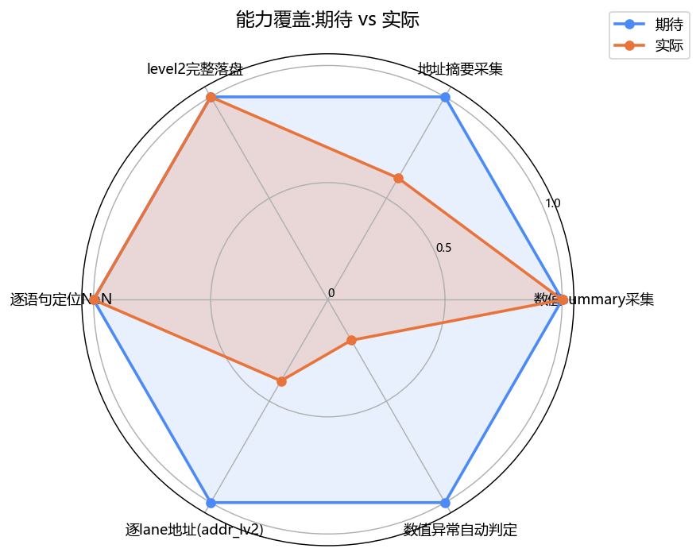
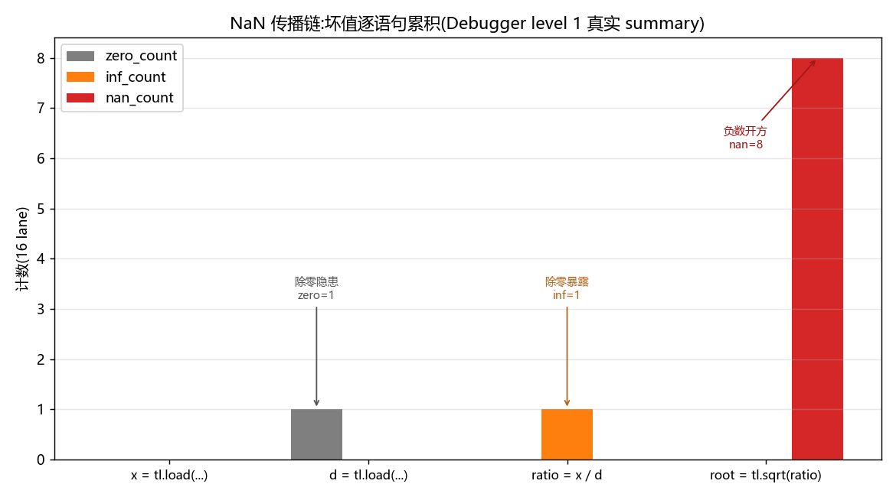
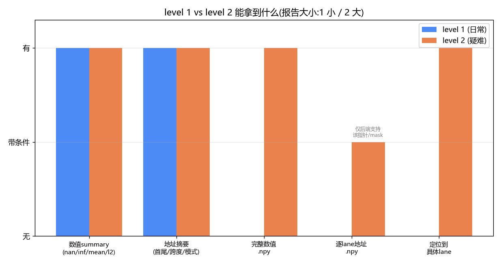

# Kernel Profiling and Debugging — Debugger

> Experiment name: **Kernel Profiling and Debugging** (Iluvatar / CoreX, BI-V150).
> This part is the Debugger experiment; the companion Profiler part is in `../flagtree_profiler/`, and the collection is in `../README.md`.

This document records a complete Debugger experiment, split into two major parts:
**Part One "Make the inside of the kernel visible"** (install software → understand the principles → run the experiment),
**Part Two "Read the report, locate the anomaly"** (look at the four kinds of report files → read the summary and address summary → catch a real NaN).
We assume this is your first time with these tools, so every new term is explained the first time it appears.

> The companion Profiler experiment is in `../flagtree_profiler/`. The Profiler answers "**which kernel is slow**",
> the Debugger answers "**are the values and memory access addresses computed by each statement inside the kernel correct**". The two ship in the same
> FlagTree wheel, but they solve problems at different levels.

## First, get a few terms straight

- **GPU kernel**: a small computation program that actually runs on the graphics card. A single pass through a model launches
  hundreds or thousands of kernels behind the scenes.
- **Triton**: a tool for writing GPU kernels in Python syntax, simpler than writing CUDA directly. All the kernels in this experiment
  are written in Triton.
- **debugger**: this is not a debugger in the traditional "set breakpoints, single-step" sense. The FlagPrism Debugger
  **records the intermediate values computed by each Triton statement inside the kernel, as well as the memory addresses it reads and writes**, then exports them into
  a report afterward. You use it to answer: does this step's result contain NaN/Inf? Is the memory access address aligned?
  Are the read/write ranges out of bounds?
- **FlagTree / FlagPrism**: FlagTree is a Triton environment that supports a variety of domestic graphics cards; FlagPrism is a set of tools
  inside it, containing two things — the **Debugger** and the **Profiler**.
  This experiment uses only the Debugger.
- **Iluvatar / iluvatar / CoreX / tianshu**: these all refer to the same graphics card vendor "Iluvatar Corex" and its software stack.
  Different contexts use different names; whichever you encounter, just treat it as "Iluvatar". The card model used on this machine is **BI-V150**.
- **summary (numeric summary)**: the Debugger does not store all of the thousands of numbers in a tensor (that would be too large), but computes a few
  statistics: element count, NaN count, Inf count, mean, min, max, L2 norm. This is called the summary.
- **artifact (full dump)**: only available at level 2, it stores the **complete values** of a statement's result and **all memory access addresses**
  into `.npy` files. Only needed when troubleshooting tricky problems.

## Files in this directory

- `exp_debugger_tianshu.py` — the experiment main script (two kernels, vector_add + rmsnorm, with collect markers)
- `exp_catch_nan.py` — use the Debugger to catch a real NaN/Inf, demonstrating its most core use
- `flagprism_report_summary.py` — report summary + visualization tool, parses the report json into a text table and png chart (see Step 7)
- `make_gap_charts_debugger.py` — the script that generates the "expected vs actual" capability/boundary comparison charts (see Step 9)
- `README.md` — this file

---
---

# Part One: Make the inside of the kernel visible

## Step 1: Install the software

Exactly the same as the Profiler — the FlagPrism Debugger and Profiler **ship in the same FlagTree wheel**,
so installing FlagTree gives you both tools at once, no separate installs needed.

```bash
# Prerequisite: install PyTorch first

# 1. First uninstall the community-edition triton, otherwise it conflicts with the one bundled in FlagTree.
#    Sometimes a single uninstall isn't clean, so re-run this command until it reports no triton left to uninstall.
python3 -m pip uninstall -y triton

# 2. Tell pip to download from FlagOS's private package source (this package isn't on the public pip source)
RES="--index-url=https://resource.flagos.net/repository/flagos-pypi-hosted/simple"

# 3. Install the Iluvatar edition of FlagTree. The iluvatar3.6 in the version number marks it as the Iluvatar-specific edition.
python3.12 -m pip install flagtree===0.7.1a1+iluvatar3.6 $RES
```

> **When do you need to compile it yourself?** If what you got is the core-only edition of FlagTree (without FlagPrism), or you're developing
> inside your own checkout of the FlagTree source, you have to build jointly from source. The Debugger source is located at
> `third_party/FlagPrism/Debugger`, and the main project compiles it into the same wheel via a single switch:
>
> ```bash
> cd /path/to/FlagTree
> git submodule update --init --recursive
>
> export FLAGTREE_BACKEND=iluvatar        # Iluvatar backend (tianshu also works)
> export FLAGPRISM_BACKEND=tianshu        # compile only the Iluvatar adaptation, don't probe Ascend CANN
> export TRITON_BUILD_FLAGPRISM=ON        # the key switch: only ON compiles the Debugger/Profiler in
> export MAX_JOBS=16
>
> python3 -m pip install . --no-build-isolation
> ```
>
> `TRITON_BUILD_FLAGPRISM=ON` compiles the Debugger, Profiler, and their native
> runtime together in the same CMake graph, packing them into the same wheel. Setting it to `OFF` gives core-only, without these two tools.
> There are only two release modes, "FlagPrism joint build" and "core-only" — **there is no standalone Debugger-only wheel**.
> If you normally use the prebuilt wheel, you don't need to worry about this section.

**Check whether it installed** (if none of these error out, it succeeded):

```bash
# Can the Debugger be imported? (the only public import path is flagtree.debugger)
python3.12 -c "import flagtree.debugger as d; print('debugger OK', d.__file__)"

# Are the native bindings on both the compiler side and the runtime side present?
python3.12 -c "import flagtree.debugger as d; print('available =', d.is_available())"

# Is the language extension where the collect markers live present?
python3.12 -c "import flagtree.language as ftl; print('ftl OK')"
```

> `d.is_available()` returning `True` means the native bindings on both the compiler and runtime sides are available at the same time.
> If it's a core-only wheel, the `import flagtree.debugger` step fails outright — that means the Debugger wasn't compiled into
> this package at all, and you need to switch to a FlagPrism joint-build wheel.

## Step 2: Understand how the Debugger works

### What question does it answer

You wrote a Triton kernel and the result came out wrong (there's NaN, numeric drift, or a suspected out-of-bounds memory access), but the kernel
runs on the graphics card, `print` can't get in, and you can't see what each intermediate step computed. **The Debugger records the result and
memory access address of each statement inside the kernel and exports them into a report afterward**, letting you check them line by line.

### A core idea: only collect the segment you mark out

The Debugger does not record the whole kernel, nor does it record every Python/PyTorch operation. It only records
**the segment of Triton statements that you mark out with markers** inside `@triton.jit`:

```python
import flagtree.language as ftl

ftl.debug_collect_start(level=1, addr_level=1)   # collection starts here
x = tl.load(x_ptr + offsets, mask=mask, other=0.0)
y = tl.abs(x)
z = y + 1.0
tl.store(y_ptr + offsets, z, mask=mask)
ftl.debug_collect_end()                          # ends here
```

Keep the division of labor between the two sides clear:

- **`flagtree.debugger` (Python side)**: responsible for configuration, toggling the pipeline, exporting reports. Use `configure()`
  to set defaults, `activate()` to turn on, `deactivate()` to turn off.
- **`ftl.debug_collect_start / end` (kernel side)**: responsible only for **demarcating** the IR region to collect inside `@triton.jit`.
  It configures nothing, it just "marks out the region".

`debugger.activate()` must be called **before compiling the kernel to be debugged** — it turns on a process-level collection pipeline.

### Collection level: level and addr_level

How much the Debugger collects is controlled by two knobs. They are set via `activate()`, and can also be specified individually for a given segment in
`debug_collect_start()`.

| Knob | Value | Meaning |
|------|------|------|
| `level` | 1 | Collect only the **numeric summary** (nan/inf/mean/min/max/l2_norm and other statistics) |
| `level` | 2 | summary **plus** exporting the complete tensor values into `.npy` artifacts |
| `addr_level` | 0 | Do not collect memory access addresses |
| `addr_level` | 1 | Collect the **address summary** of load/store (first/last address, stride, access pattern, etc.) |
| `addr_level` | 2 | At `level=2` and when the backend supports it, additionally export the **complete address of every lane**; combined with level=1 it still only gives the summary |

Practical advice: **use `level=1, addr_level=1` day to day** — the report is small and enough to locate the vast majority of problems; only go to
`level=2` when you need to check values one by one or suspect that a lane's address was computed wrong. `level=2` requires `output_dir` to not be
`None`, and only supports the numeric and pointer patterns whose shape can be determined at compile time and that the current backend can legally lower — forcing
level 2 on an unsupported pattern errors out **at compile time**, rather than giving you a report that looks successful but is actually incomplete.

### Config option quick reference (`debugger.configure`)

| Option | Default | Meaning |
|------|--------|------|
| `output_dir` | `/tmp/flagtree_debugger_manual` | report output directory; set to `None` to disable auto dump |
| `record_capacity` | `1024` | number of device-side record slots, must be a positive integer |
| `export_mode` | `POST_KERNEL_EXPORT` | export after the kernel finishes (also accepts `STREAMING_EXPORT`) |
| `export_on_error` | `False` | whether to still try to export after the kernel errors out |
| `export_raw_records` | `False` | whether to additionally write a decoded raw-record sidecar (for protocol/decode debugging) |
| `timeline` | `False` | insert a device timestamp timeline on supported backends (currently not enabled on Iluvatar) |

> `record_capacity` matters: if a non-zero `overflow_count` appears in the report, it means there weren't enough slots and the data was truncated,
> so the report may be incomplete. Just increase the capacity and re-run. level 2 **does not allow** exporting artifacts from an overflowed buffer.

### A few facts about the Iluvatar (CoreX) path

- The Iluvatar backend is accessed through a **CUDA compatibility layer**, so in the scripts tensors are placed on `"cuda"` and synchronized with `torch.cuda.synchronize()`
  — this is not a typo, it's because Iluvatar reuses CUDA's driver API.
- When the Debugger is active, it only appends a hidden control pointer to kernels that **explicitly declare `debug_launch_hidden_arg=True`**
  (for the Iluvatar / Ascend / MUSA / MetaX / NVIDIA class of backends). The kernel launch ABI of other backends is not affected
  by the global Debugger state.
- Iluvatar's address summary is computed with scalar i64 for **provably contiguous pointer chains** (of the form `tt.addptr(tt.splat(base), offsets)` plus a leading
  mask); when it cannot be fully analyzed, it only reports the "provable" part of the address information, it does not make things up.

## Step 3: Run the experiment (make the inside of the kernel visible)

The main script `exp_debugger_tianshu.py` has two kernels:
- **`vector_add`**: adds two arrays element by element, pure memory access. Used to see what the **address summary of load/store** looks like.
- **`rmsnorm`**: with square-sum, square root, and multiply. Used to see the **numeric summary** (mean/min/max/l2_norm).

The script already has `configure()` + `activate()` written at the top of the file, with the collection level read from environment variables, defaulting to
`level=1, addr_level=1`. Just run:

```bash
python3.12 exp_debugger_tianshu.py
```

On the first run, Triton has to compile the kernel, so **there may be no output and it may hang for tens of seconds, which is normal**. When it finishes it prints a block of
JSON listing how many runs were exported this time and the path of each report.

To switch the collection level, no need to change code, just set environment variables:

```bash
# Values only, no addresses (cleanest report)
FLAGTREE_DEBUGGER_RECORD_LEVEL=1 FLAGTREE_DEBUGGER_ADDR_LEVEL=0 \
  python3.12 exp_debugger_tianshu.py

# Full dump: all values of each statement + the address of every lane, stored as .npy
FLAGTREE_DEBUGGER_RECORD_LEVEL=2 FLAGTREE_DEBUGGER_ADDR_LEVEL=2 \
  python3.12 exp_debugger_tianshu.py
```

> Tip: first get it working with the default level 1 and confirm a report comes out, then go to level 2. level 2 produces many more files,
> so don't turn it on right away.

---
---

# Part Two: Read the report, locate the anomaly

## Step 4: After collection finishes, what files do you get

The report file name is made up of "script_name_kernel_name_timestamp_run_number", and one collection run may produce these kinds:

| File | Content | When to look |
|------|------|-----------|
| `<...>.txt` | **main report**, organized by Triton source statement, for humans to read | first choice for day-to-day debugging, start here |
| `<...>.json` | JSON version of the main report, same structure | when you need to batch-process with a script |
| `<...>_op_log.txt` / `.json` | organized by MLIR `op_id`, **more complete static metadata** | when you need IR-level details, dtype/shape/alignment |
| `<...>_raw_records.txt` | decoded raw records | only generated when `export_raw_records=True`, for protocol debugging |
| `<...>_artifacts/` | the complete values/addresses `.npy` of level 2 | only generated at level 2 |

**The main report `.txt` is what you'll look at 90% of the time.** It's organized by each `tl.load / tl.store / arithmetic`
statement you wrote, placing "the summary of this statement's result" and "the address summary of this statement's memory access" in their respective spots.

### What the main report looks like (using a level 2 snippet of the abs kernel as an example)

```text
statement: x = tl.load(x_ptr + offsets, mask=mask, other=0.0)
  [result x]:
    summary:
      element_count: [16]
      nan_count    : [0]
      inf_count    : [0]
      min          : [-8.0]
      max          : [7.0]
    full_value_file: op3_inst0_rec10_value.npy        # only at level 2
    address_summary(load from):
      status            : [complete]
      first_addr        : [0x12c041200000]
      last_addr         : [0x12c04120003c]
      active_lane_count : [16]
      address_span_bytes: [64]

statement: tl.store(y_ptr + offsets, z, mask=mask)
  memory_access:
    address_summary(store to):
      status            : [complete]
      first_addr        : [0x12c041200200]
      active_lane_count : [16]
```

How to read it:

- **The `summary` of `[result x]`** describes the value `x` read in by `tl.load`: 16 elements, no NaN/Inf,
  range [-8, 7]. This is your main basis for checking "did this step compute correctly".
- **`address_summary(load from)`** describes the range of **source addresses actually read** by `x_ptr + offsets` after the mask,
  not the address of register `x` itself. `status: complete` means the address analysis is complete; `active_lane_count`
  is the number of lanes that actually participated in the memory access after the mask.
- **`address_summary(store to)`** is the same, it's the destination address written by `y_ptr + offsets`.
- `element_count` is the **logical** lane count, not equal to the effective memory-access lane count after the mask; for the latter see `active_lane_count`.

### Fields you can get at level 1

**Numeric summary** (each statement that has a result): `element_count`, `nan_count`, `inf_count`, `zero_count`,
`mean`, `min`, `max`, `l2_norm`.

**Address summary** (`addr_level=1`, each memory access op): `first_addr`, `last_addr`, `min_addr`, `max_addr`,
`active_lane_count`, `address_span_bytes`, `address_stride_bytes`, `address_pattern`
(`contiguous` / `strided` / `broadcast` / `irregular`, etc.).

### Get the export results directly in Python

If you don't want to dig through files, you can also get the path and metadata of each run in the script:

```python
runs = debugger.peek_exported_runs()   # take a look, don't clear
runs = debugger.take_exported_runs()   # return and clear (what the main script uses)
debugger.clear_exported_runs()         # clear only
```

Each `run` is a dict with these key fields: `report_path`, `json_report_path`, `op_log_report_path`,
`meta` (backend/device info), `runtime_metadata`. A level 2 run also has `full_dump_artifact_dir`,
`full_dump_index_path`.

## Step 5: Catch a real NaN (the Debugger's most useful scenario)

Just looking at a normal kernel isn't intuitive enough. `exp_catch_nan.py` deliberately writes a buggy kernel (actual code,
collecting with `level=1, addr_level=0`, values only, no addresses):

```python
x = tl.load(x_ptr + offsets, mask=mask, other=0.0)   # x = linspace(-4, 4, 16), the first 8 are negative
d = tl.load(d_ptr + offsets, mask=mask, other=0.0)   # d = ones, but d[3] is changed to 0
ratio = x / d          # d[3]=0 -> this produces inf
root  = tl.sqrt(ratio) # ratio contains negatives -> this produces nan
```

Without the Debugger on, you can only see nan/inf in the output on the host side, but you **don't know which statement, or from which step it went
bad**. With the Debugger on, the level 1 summary pinpoints the problem precisely to the statement. Run:

```bash
python3.12 exp_catch_nan.py
```

What the host side actually prints (the first 8 outputs are nan, the last 8 are normal):

```text
output = [nan, nan, nan, nan, nan, nan, nan, nan, 0.5163975954055786, 0.8944271206855774, ...]
host-side stats: nan = 8  inf = 0
report_path = /tmp/flagtree_debugger_nan/exp_catch_nan_buggy_kernel_..._run1.txt
```

Open the "Triton Statement Records" of that `.txt` report, and the actual content is as follows (a real collection result,
the `(U64)`/`(F32)` after the values are data type annotations):

```text
statement: d = tl.load(d_ptr + offsets, mask=mask, other=0.0)
  [result d]:
    summary:
      zero_count   : [1 (U64)]      # ← d contains 1 zero, this is the buried division-by-zero hazard
      min          : [0 (F32)]

statement: ratio = x / d
  [result ratio]:
    summary:
      inf_count    : [1 (U64)]      # ← the division by zero surfaces here: x/0 = inf
      nan_count    : [0 (U64)]
      min          : [-4 (F32)]     # ← ratio contains negatives, the next step's sqrt will go wrong

statement: root = tl.sqrt(ratio)
  [result root]:
    summary:
      nan_count    : [8 (U64)]      # ← sqrt of negatives (and that inf) all turn into nan here
      inf_count    : [0 (U64)]
```

**This is the value of the Debugger:** the host side can only tell you "the final output has 8 nans", while the Debugger unfolds the chain step by step:
at the `d` step you can already see `zero_count=1` (the buried division-by-zero hazard) → `x / d` produces 1 inf (division by zero), and `min=-4`
shows ratio contains negatives → `tl.sqrt` turns those negatives and that inf together into 8 nans. From which statement and which step the bad values
start is crystal clear. After locating it, go back to the source and fix it: `d_safe = tl.where(d == 0, 1.0, d)` to prevent division by zero,
`tl.sqrt(tl.maximum(ratio, 0.0))` to prevent sqrt of negatives — patch both to be fully clean.

> To further learn "which lanes went bad", change the script to `level=2`, read the corresponding statement's
> `*_value.npy` in `_artifacts/`, and use numpy to find the indices where `isnan` is true. level 1 gives "how many bad values", level 2 gives
> "exactly which ones". The next step demonstrates exactly this.

## Step 6: Going to level 2 — full dump and locating exactly which lanes

The level 1 summary only tells you "this statement has 8 nans", but doesn't say **which** lane went bad. To be precise down to the lane,
you need to turn on level 2: beyond the summary, it dumps the **complete tensor values** of each statement's result (and, when the backend supports it, the **per-lane
memory access addresses**) to disk as `.npy` artifacts, and then you use numpy to pick out the bad indices yourself.

### How to turn on level 2

The main script `exp_debugger_tianshu.py` reads the collection level from environment variables, so just switch it directly; the NaN-catching
`exp_catch_nan.py` hardcodes `level=1`, so either change two lines or turn it on separately with the minimal snippet below:

```python
# Three key points: level=2, give addr_level 2 if you want per-lane addresses, output_dir must not be None
debugger.configure(output_dir=Path("/tmp/flagtree_debugger_nan_lv2"),
                   record_capacity=2048)
debugger.activate(level=2, addr_level=2)
# The in-kernel marker must also be synced to level=2:
#   ftl.debug_collect_start(level=2, addr_level=2)
```

With the main script, one line of environment variable does it (no code change needed):

```bash
FLAGTREE_DEBUGGER_RECORD_LEVEL=2 FLAGTREE_DEBUGGER_ADDR_LEVEL=2 \
  python3.12 exp_debugger_tianshu.py
```

> Three hard constraints, hitting them errors out **at compile time** (rather than giving you a defective report):
> 1. At `level=2`, `output_dir` **cannot be `None`**, otherwise there's nowhere to dump.
> 2. Only numeric/pointer patterns whose shape can be determined at compile time and that the current backend can legally lower are supported; forcing 2 on an unsupported pattern errors out.
> 3. If `record_capacity` overflows (non-zero `overflow_count` in the report), level 2 **does not allow** exporting artifacts from an overflowed buffer. Increase the capacity and re-run.

### The extra files at level 2

Compared to level 1, each run gets one more `_artifacts/` directory and an index:

| File/Directory | Content |
|-----------|------|
| `<...>_artifacts/` | the `.npy` of each statement's result, with file names like `op3_inst0_rec10_value.npy` |
| `*_value.npy` | the **complete values** of this statement's result (always present at level 2) |
| `*_memory_address.npy` | the **per-lane addresses** of this memory access (only present when `addr_level=2` and the backend supports that pointer/mask pattern) |
| `full_dump_index` (run field `full_dump_index_path`) | the mapping table of statement → corresponding `.npy` file |

The corresponding statement in the main report `.txt` gets one extra line `full_value_file: op3_inst0_rec10_value.npy`, telling you which one to read.
You can also get the directory directly in Python:

```python
runs = debugger.take_exported_runs()
run = runs[0]
print(run["full_dump_artifact_dir"])   # absolute path of _artifacts/
print(run["full_dump_index_path"])     # the index file, containing the statement→npy mapping
```

### Use numpy to pick out the bad lanes

Taking the NaN example from Step 5, after `root = tl.sqrt(ratio)` is dumped:

```python
import numpy as np

root = np.load("/tmp/flagtree_debugger_nan_lv2/..._artifacts/opX_instY_root_value.npy")
print("bad lane indices:", np.where(np.isnan(root))[0])   # -> [0 1 2 3 4 5 6 7]
print("bad value count:", int(np.isnan(root).sum()))      # -> 8, matches level 1's nan_count

# To find which memory access address, read the corresponding *_memory_address.npy (only present when addr_level=2 and the backend supports it)
addr = np.load("/tmp/flagtree_debugger_nan_lv2/..._artifacts/opX_instY_memory_address.npy")
print("source addresses of the first 8 bad lanes:", [hex(int(a)) for a in addr[:8]])
```

This takes "there are 8 nans" down to the precision of "lanes 0-7 are bad, and which block of memory each read" — exactly matching the first 8 negatives of the input
`x = linspace(-4, 4, 16)`. **level 1 locates to the statement, level 2 locates to the lane and address.**

> Practical reminder: the number of files produced by level 2 grows linearly with the number of statements and records, so don't mindlessly turn it fully on for a big kernel.
> A common practice is to first narrow the suspect statements down to one or two with level 1, then turn on level 2 only for that segment.

## Step 7: Use a script to summarize/visualize the report (optional)

Manually flipping through the `.txt` report suits single-issue troubleshooting; if you want to **see at a glance** the numeric trend of all statements in one run, or you want to
compare across multiple runs, use this directory's `flagprism_report_summary.py`. It parses the report **json** (the structured
version of the main report `.txt`) and outputs two things:

1. **Text summary table** — lists `elem/nan/inf/zero/min/max/mean/l2` per statement, and automatically prints the conclusion lines
   "first statement to show inf" and "first statement to show nan", pointing out the source of the anomaly in one line.
2. **`--plot` png chart** — the top half is a bar chart of the nan/inf/zero counts per statement, the bottom half is a line chart of
   min/max/mean/l2_norm as the statements progress, making it obvious at which step the values blow up. Requires matplotlib
   (automatically skipped if not installed, text only).

```bash
# Auto-find the latest main report under /tmp/flagtree_debugger_*, print the text table
python3 flagprism_report_summary.py

# Text + chart (the chart is saved by default to *_summary.png in the report's own directory)
python3 flagprism_report_summary.py --plot

# Specify a particular report
python3 flagprism_report_summary.py /tmp/flagtree_debugger_nan/exp_catch_nan_buggy_kernel_xxx_run1.json --plot

# When fields don't match / the table is empty, look at the structure it actually parsed out
python3 flagprism_report_summary.py <json_path> --dump
```

For the NaN report from Step 5, the text table directly gives: `ratio = x / d` first shows inf, `root = tl.sqrt(ratio)`
first shows nan — the same conclusion you'd get reading the summary manually, but without flipping through line by line.

> The field hierarchy may differ slightly across FlagPrism versions, so the script does adaptive probing (it can parse values with type
> suffixes like `[16 (U64)]`). If it can't parse, first use `--dump` to see the structure, then adjust. The chart titles contain Chinese, and if the machine
> has no Chinese font they'll show as boxes, which doesn't affect the data.

## Step 8: What this experiment proved, and the boundaries to note

**What it can do:**
- The numeric summary (nan/inf/mean/min/max/l2_norm) of each statement inside the kernel is visible.
- The address summary of load/store (first/last address, stride, access pattern, effective lane count) is visible.
- level 2 can dump the complete values and per-lane addresses to disk as `.npy`, for checking one by one.
- It can take an "output has NaN" problem and pinpoint it precisely to **exactly which Triton statement**.

**Boundaries to know (Iluvatar / current version):**
- **Address analysis is only complete for "provable" pointer chains.** Iluvatar computes the address summary with scalar i64 for contiguous pointer chains;
  for pointer/mask patterns it cannot fully analyze, it only reports the part it can prove, it does not fabricate lane addresses. This is a limitation of the current
  CoreX TTIR→TTGIR conversion, not a limitation of the hardware address bit width.
- **`addr_level=2` (complete per-lane addresses) is only available when the backend supports that pointer/mask pattern**; only then is
  `*_memory_address.npy` generated.
- **The device instruction timeline is currently not enabled on Iluvatar** (`timeline=True` only takes effect on NVIDIA/Ascend).
- **Numeric error diagnosis only covers direct fp16/bf16/fp32 conversions** (`arith.truncf/extf`, which report precision_conversion).
  **Automatic detection** of long-computation-chain accumulated drift, raw-bit/ULP analysis, near-zero divisors, and sqrt of negatives is not yet done — so the above
  NaN example relies on you reading the summary to locate it; the Debugger currently will not automatically conclude "there was a division by zero here".
- **The hidden-argument ABI does not yet penetrate arbitrary call graphs**: helpers/callees whose signatures cannot be safely rewritten stay
  metadata-only, to avoid the Debugger changing the original kernel's semantics.
- The report can currently compare by program instance and view lane addresses at level 2, but it **cannot yet** directly output warp id,
  anomalous lane clustering, or "suspicious memory access context" conclusions.

### One-line summary

**The Debugger turns the inside of a Triton kernel from a "black box" into "checkable statement by statement".** Day to day, using `level=1, addr_level=1`
to look at the summary and address summary is enough to locate the vast majority of numeric/memory-access problems; for tricky problems, go to `level=2` and dump the complete data.
The main boundaries of the Iluvatar path are: address analysis is only complete for provable pointer chains, the instruction timeline is not enabled, and numeric anomalies rely on
you reading the summary to locate rather than automatic detection.

## Step 9: Expected vs actual — capability/boundary comparison charts

Putting the "what it can do" and "boundaries to know" from Step 8 into charts makes it clear at a glance where this toolset stands on the current Iluvatar version, and what's still missing.
The numbers in the charts are all hardcoded to the real results recorded in Steps 5/8 of this experiment, generated with `make_gap_charts_debugger.py`:

```bash
pip install matplotlib numpy

# Generate 4 png charts in the current directory
python make_gap_charts_debugger.py
# Generates: gap_1_radar.png / gap_2_nan_chain.png / gap_3_levels.png / gap_4_availability.png
```

### What each of the four charts shows

**Chart 1 Capability radar** (`gap_1_radar.png`): the blue line is expected, the orange line is actual. Where they overlap means the capability is in place
(numeric summary, level 2 full dump, locating NaN statement by statement are all done); the dips are "address summary"
(only complete for provable pointer chains), "per-lane addresses" (only present when the backend supports that pointer/mask pattern), and
"automatic numeric-anomaly detection" (currently relies on a human reading the summary, the tool doesn't conclude).



**Chart 2 NaN propagation chain** (`gap_2_nan_chain.png`): draws the real report from Step 5 as bars — the `d = load`
step has `zero_count=1` burying the division-by-zero hazard → `ratio = x/d` produces `inf_count=1` → `root = sqrt`
turns into `nan_count=8` all at once. From which statement the bad values surface and how they accumulate is unfolded step by step. This is exactly the core value of the Debugger:
the host side only knows "the output has 8 nans", the Debugger points out the chain statement by statement.



**Chart 3 level 1 vs level 2** (`gap_3_levels.png`): day-to-day level 1 gives the numeric summary + address summary,
small report; level 2 additionally dumps the complete values and (when the backend supports it) per-lane addresses to `.npy`, able to locate exactly which
lanes are bad, but with many more files. First get it working with level 1, go to level 2 for tricky cases.



**Chart 4 Capability availability heat table** (`gap_4_availability.png`): YES/~/NO lists in one row what the Iluvatar CoreX current version
actually has. Done: numeric summary, address summary, level 2 dump, locating to the statement, fp conversion precision diagnosis;
with reservations (~): complete per-lane addresses (depends on backend pointer/mask support); not yet available: instruction timeline,
automatic detection of division-by-zero/sqrt-of-negative, hidden-argument ABI that penetrates arbitrary call graphs, warp/anomalous-lane clustering.


> The charting script is `make_gap_charts_debugger.py`, and the numbers inside are hardcoded to the real results of this experiment. To swap in your own data,
> open that file, change the corresponding values, and re-run. The chart titles contain Chinese, and if the machine has no Chinese font it automatically falls back to English labels.

---

## Appendix: Comparison with the Profiler experiment

| | Profiler (`../flagtree_profiler`) | Debugger (this directory) |
|---|---|---|
| What it answers | which kernel is slow, how much data was moved, whether the card is fully utilized | are the values and memory access addresses of each statement inside the kernel correct |
| Public import | `import flagtree.profiler` | `import flagtree.debugger` |
| In-kernel annotation | `profiler.scope(...)` / `hook="triton"` | `ftl.debug_collect_start/end` |
| Iluvatar launch method | must wrap the script with `flagtree-profiler --ixkn` | just run `python` directly, no CLI wrapper needed |
| Output | `.hatchet / .timeline.json / .meta.json / .vendor.json` | `.txt / .json / _op_log / _artifacts` |
| Viewing results | `flagtree-profiler-viewer` | read the `.txt` report directly / read run fields |
| Install method | the same FlagTree wheel | the same FlagTree wheel |

