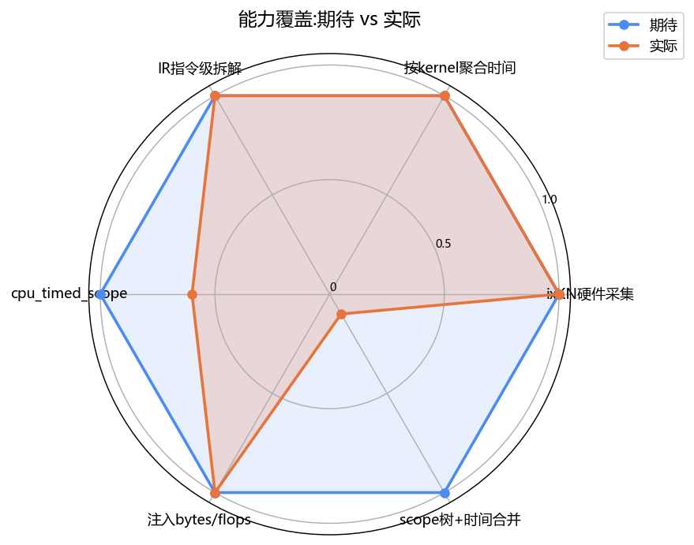
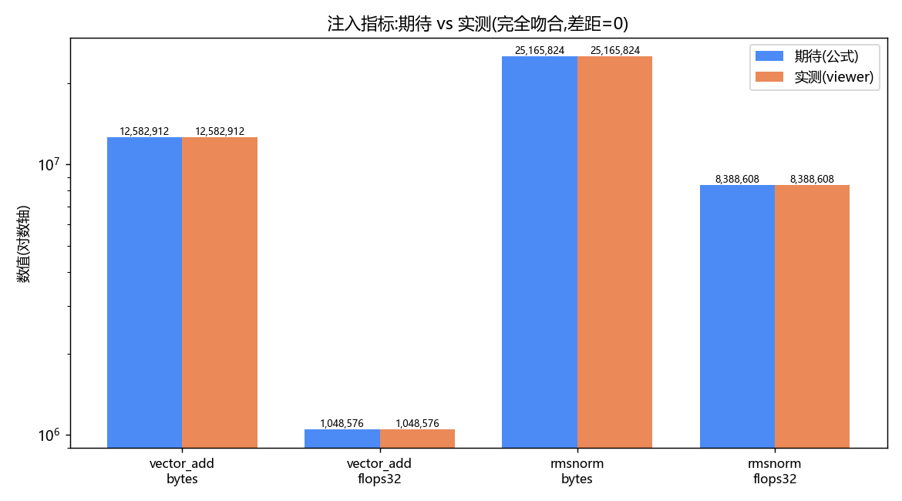
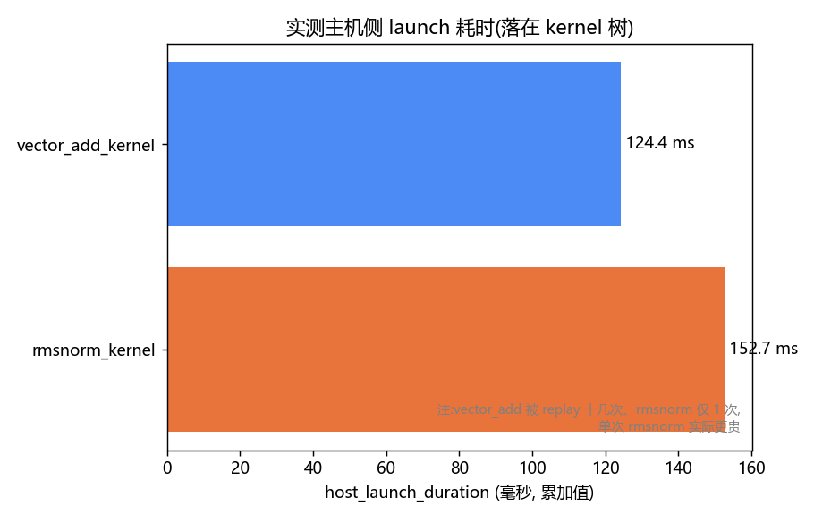
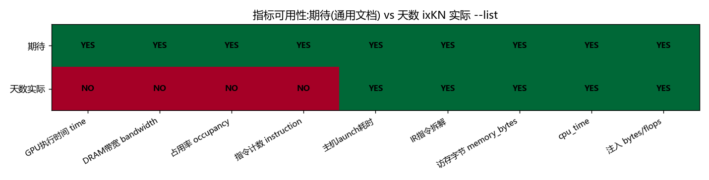

# Kernel Profiling and Debugging — Profiler

> Experiment name: **Kernel Profiling and Debugging** (Iluvatar / CoreX, BI-V150).
> This part is the Profiler experiment; the companion Debugger part is in `../flagtree_debugger/`, and the collection is in `../README.md`.

This document records one complete profiler experiment, in two major parts:
**Part One "Measuring Kernel Performance"** (install software -> understand the principles -> run the experiment),
**Part Two "Interpreting the Results"** (read the report -> read the real data -> gap analysis).
It assumes you are encountering these tools for the first time, so every new term is explained the first time it appears.

## First, let's clarify a few terms

- **GPU kernel**: a small computation program that actually runs on the graphics card. For example, "adding two arrays element by element"
  is a kernel. Running a single pass of a deep learning model launches hundreds or thousands of kernels behind the scenes.
- **Triton**: a tool for writing GPU kernels in Python syntax, simpler than writing CUDA directly. The two
  kernels in this experiment are written with Triton.
- **profiler**: a tool that "measures the speed" of a program. It tells you which kernel is slow,
  where it is slow, how much time it took, and how much data it moved. Without it, you can only guess.
- **FlagTree / FlagPrism**: FlagTree is a Triton environment supporting a variety of domestic graphics cards; FlagPrism is a toolset
  inside it, containing two things -- the **Debugger** and the **Profiler**.
  This experiment uses only the Profiler.
- **Iluvatar / CoreX / tianshu / corex**: all refer to the same graphics card vendor "Iluvatar Corex" and its software stack.
  Different contexts use different names; whichever one you run into, just treat it as "Iluvatar". The card model used on this machine is **BI-V150**.

## Files in this directory

- `exp_profiler_tianshu.py` — main experiment script (two Triton kernels + performance tagging)
- `exp_basic_usage.py` — example script for the two basic usages (profile a function / profile a region)
- `make_gap_charts_profiler.py` — script that generates the "expected vs actual" comparison charts
- `README.md` — this file

---
---

# Part One: Measuring Kernel Performance

## Step 1: Install the software

Here we directly use a prebuilt installation package (the jargon is **wheel**), rather than compiling from source yourself. The package already bundles
FlagPrism, so there is no need to install the profiler separately.

```bash
# Prerequisite: install PyTorch first

# 1. Uninstall the community triton first, otherwise it will conflict with the one bundled in FlagTree.
#    Sometimes one uninstall is not enough, so repeat this command until it reports there is no triton to uninstall.
python3 -m pip uninstall -y triton

# 2. Tell pip to download from FlagOS's private package source (this package is not on the public pip index)
RES="--index-url=https://resource.flagos.net/repository/flagos-pypi-hosted/simple"

# 3. Install the Iluvatar build of FlagTree. The iluvatar3.6 in the version number marks it as the Iluvatar-specific build.
python3.12 -m pip install flagtree===0.7.1a1+iluvatar3.6 $RES
```

After installation, FlagPrism's files appear in these two locations (just so you know; you normally don't touch them):

```
/root/FlagTree/python/flagtree/_flagprism.py        # internal file, loads components and checks versions, do not use directly
/root/FlagTree/python/test/unit/test_flagprism.py   # the test code for the file above
```

Note: **what you actually use when writing code is `import flagtree.profiler`**, not the `_flagprism` above.
The `_flagprism` name has a leading underscore, which by Python convention means "internal part, outsiders keep off".

**Check that it installed correctly** (if all four commands run without error, it succeeded):

```bash
# Can the profiler be imported?
python3.12 -c "import flagtree.profiler as p; print('profiler OK', p.__file__)"

# Is the underlying collection engine present?
python3.12 -c "import flagtree.profiler._native; print('native OK')"

# Are the command-line tools installed? (should print two paths)
which flagtree-profiler flagtree-profiler-viewer

# Optional: run the bundled official tests to confirm FlagPrism is fine
python3.12 -m pytest /root/FlagTree/python/test/unit/test_flagprism.py -v
```

## Step 2: Understand how the profiler works

### What question is it answering

You have a Triton program running on the graphics card and want to know: **which kernel is slow, how much time the CPU and GPU each spent,
and how much memory traffic there is.** The profiler measures these numbers for you and organizes them by "code structure".

### A core idea: "tag" code regions

The profiler does not dump every kernel's data at you all at once; instead it lets you **partition and tag your code**, then attributes
each kernel's time to the corresponding tag. This way, what you see is not a pile of isolated numbers but "how much
time each functional module spent". There are two ways to tag:

- **python mode**: automatically uses "which file, which function, and which line this kernel was called from" as the tag.
- **shadow mode**: you manually enclose a region as a tag with `with profiler.scope("name"):`.
  This experiment uses this mode.

For example, the script writes it like this:

```python
with profiler.scope("elementwise"):   # attach a tag called elementwise
    vector_add(x, y)                   # the kernels run inside here are attributed to this tag
```

### Where the data comes from: the collection backend

The part that actually reads performance data from the graphics card is called the **backend**; different cards use different backends. The backend Iluvatar uses
is called **ixKN** (think of it as the Iluvatar speed probe).

Here is an Iluvatar-specific gotcha to remember: **ixKN must be attached the moment the program starts**, and cannot be turned on halfway through.
So on Iluvatar you **cannot rely on just writing `profiler.start()` in the script**; instead you use a command-line tool
`flagtree-profiler --ixkn` to "wrap" your script when running it. Step 3 below explains this in detail.

### Extra feature: supply "theoretical data" to a kernel

The profiler measures actual elapsed time, but it does not know how many bytes a kernel "should" move or how many ops it should compute in theory.
You can use `hook="triton"` to configure a small function that tells it these theoretical values before each kernel launches
(for example, `bytes` = the number of bytes to move, `flops32` = the number of floating-point operations to compute). This way the report has both measured time
and theoretical amounts, making it easier to judge "whether this kernel is fully utilizing the graphics card".

### The docs also have two "basic usages"

The above describes tagging with `scope`. The official docs also mention two more basic usages, demonstrated in
`exp_basic_usage.py`:

- **Usage 1: profile an entire function** -- `profiler.profile(func, name=..., context=...)(args)`.
  First wrap the function, then follow it with `(args)` to actually execute and measure it.
- **Usage 2: profile a region, and skip the middle** -- `start` begins, `deactivate` pauses,
  `activate` resumes, `finalize` finishes. Suited to the "I only want to measure some sections" scenario.

```bash
python3.12 exp_basic_usage.py
```

Running it produces two result files: `basic_profile_fn.hatchet` (usage 1), `basic_region.hatchet` (usage 2).
View them the same way as the main experiment: first `--list` to see the metrics, then use a real metric name:

```bash
flagtree-profiler-viewer --list basic_profile_fn.hatchet
flagtree-profiler-viewer -m flagtree.ir.host_launch_duration_ns,cpu_time/ns \
  basic_region.hatchet --print-sorted
```

Two Iluvatar-specific details:
1. The Iluvatar backend **does not allow two sessions open at the same time**, so usage 1 manually `finalize`s when it ends, so that usage 2 can `start` again.
2. In this build, `profiler.profile(...)(args)` returns the **function's computed result** (a tensor), not the session_id the docs describe.

Usage 2 is a good place to verify whether "skipping" works: the script runs `vector_add` 15 times (section A 5 + skipped section B 5 +
section C 5); if `deactivate` works, the result should correspond to only **10 runs (A+C)**.

## Step 3: Run the experiment (produce the performance data)

This experiment script contains two Triton kernels:
- **`vector_add`**: adds two arrays element by element. It does almost no computation and is all data movement -- a textbook "memory-bound" case.
- **`rmsnorm`**: a normalization operation commonly used in deep learning, involving summation, square root, and multiplication, with a slightly larger compute load.

Comparing these two clearly shows the elapsed-time difference between different types of kernels.

There are two ways to run it. **We recommend running mode 2 first to confirm the script is correct, then running mode 1 for the real measurement.**

### Run the verification script: run the script directly

This mode does not enable ixKN; it just confirms the script runs through and the kernel computes correctly.

```bash
python3.12 exp_profiler_tianshu.py
```

On the first run, Triton has to compile the kernel into code the graphics card can execute, and this step **produces no output and may appear to hang
for tens of seconds to a minute, which is normal, so be patient**. When you finally see "profile written out" printed, it succeeded.

### Run the real measurement script: wrap the script with the command-line tool

As mentioned earlier, Iluvatar's ixKN must be attached from the program start, so you run the script with `flagtree-profiler --ixkn`.

```bash
# The simplest form
flagtree-profiler --ixkn -b iluvatar -c shadow -k triton -n prof_tianshu \
  exp_profiler_tianshu.py
```

Parameter explanation:
- `--ixkn`: enable Iluvatar's ixKN measurement (required on Iluvatar).
- `-b iluvatar`: select the Iluvatar backend. Iluvatar has three names `iluvatar` / `tianshu` / `corex`; any of them works the same.
- `-c shadow`: tag using shadow mode (corresponds to `profiler.scope` in the script).
- `-k triton`: enable the "supply theoretical data to a kernel" feature mentioned earlier.
- `-n prof_tianshu`: give this measurement a name; the result files will be called `prof_tianshu.xxx`.

To measure faster and with more control, you can add the following parameters to limit the collection scope:

```bash
flagtree-profiler --ixkn -b iluvatar -c shadow -k triton -n prof_tianshu \
  --ixkn-devices 0 \
  --ixkn-section all \
  --ixkn-launch-skip 2 \
  --ixkn-launch-count 20 \
  --ixkn-export-profile prof_tianshu.ixkn \
  exp_profiler_tianshu.py
```

| Parameter | Effect |
|------|------|
| `--ixkn-devices 0` | measure only GPU 0 |
| `--ixkn-section all` | collect all available metrics |
| `--ixkn-launch-skip 2` | skip the first 2 kernel launches (usually warmup, which you don't want to count) |
| `--ixkn-launch-count 20` | measure at most 20 kernel launches (fewer is faster) |
| `--ixkn-export-profile prof_tianshu.ixkn` | save ixKN raw data to this file |

> Tip: on your first real measurement, set `--ixkn-launch-count` to a small value (say 4) to first confirm the whole flow
> runs through, then open it up to collect the full set. This avoids waiting a long time only to get stuck at some step.

After a successful run, you get a result file `prof_tianshu.hatchet`; Part Two below is all about reading it.

---
---

# Part Two: Interpreting the Results

## Step 4: Open the result file

The measurement result is stored in a format called **hatchet** (`prof_tianshu.hatchet`), which you view with the companion viewer tool.

```bash
# The viewer depends on the hatchet library, so install it first. Note the package name is llnl-hatchet, not hatchet!
pip install llnl-hatchet
```

**First thing: look at exactly which metrics this result actually contains.** Do not copy metric names from online docs, because the metrics
Iluvatar can provide differ from those of other graphics cards.

```bash
flagtree-profiler-viewer --list prof_tianshu.hatchet
```

> The most common beginner pitfall: writing `-m time/ns` directly errors out with `Metric time is not found`. Because on this Iluvatar path
> **there simply is no metric called `time`**. You must use `--list` first to see what exists, then pick from it.

After reading `--list`, query with a metric name that actually exists. The time-related metric here on Iluvatar is called
`flagtree.ir.host_launch_duration_ns`:

```bash
# See each kernel's elapsed time (--print-sorted sorts from largest to smallest)
flagtree-profiler-viewer -m flagtree.ir.host_launch_duration_ns,cpu_time/ns \
  prof_tianshu.hatchet --print-sorted

# See whether the theoretical data injected by the script (byte count, flop count) was recorded correctly
flagtree-profiler-viewer -m bytes,flops32 prof_tianshu.hatchet --print-sorted

# Look only at the parts whose name contains rmsnorm
flagtree-profiler-viewer -m flagtree.ir.host_launch_duration_ns \
  prof_tianshu.hatchet -i "rmsnorm"

# See all command options
flagtree-profiler-viewer -h
```

### The three kinds of metrics you'll see in the report

Each metric name may carry a suffix indicating whether it can be accumulated up to a parent tag:

- `(inc)` or no suffix: can be accumulated to the parent tag (e.g. time).
- `(exc)`: not accumulated upward (e.g. CPU time; accumulating it would double-count).
- `(pty)`: just an attribute, not accumulated.

## Step 5: Understand the results this experiment actually produced (Iluvatar BI-V150, 2026-11-05)

Below are the real data produced and the pitfalls encountered, reproducible by following along.

### 1. What the on-screen messages during measurement mean

When running mode 1, the screen scrolls a lot of `Replaying kernel ...`; line by line:

- `IXKN-CLI is profiling on Iluvatar BI-V150` -- ixKN successfully attached to the Iluvatar BI-V150 card.
- The log automatically replaced `-b iluvatar` with `--backend tianshu` -- confirming "the three names are the same thing".
- At the start there are two kernels with **extremely long names** (`distribution_elementwise_...`); those are used by `torch.randn`
  when generating random input data, not the operators we want to measure, and their appearance is normal.
- `Replaying kernel "vector_add_kernel"` / `"rmsnorm_kernel"` -- our two kernels are being
  "replayed" and measured one by one. To measure accurately, ixKN runs the same kernel several more times, which is called replay.
- There is one **warning** worth remembering:
  `Warning: Kernel Replay may FAIL when HOST MEMORY is used, please use '--replay-mode application'`
  -- it means that when measuring via replay, if the program used a certain special kind of memory, the hardware metrics inside the graphics card may not be measurable.
  This time it did not error, but this is exactly the reason for later "not getting the GPU's true execution time".

### 2. The first pitfall: the `time` metric does not exist

At first, following generic docs, we wrote `-m time/ns` and got an immediate error:

```
RuntimeError: Metric time is not found. Use the --list flag to list available metrics
```

Using `--list` shows that the metrics Iluvatar actually has are these:

```
Accumulable metrics:
- bytes / flops32                     # these two are theoretical values injected by the script itself
- flagtree.ir.host_launch_duration_ns # host-side launch time <- the only thing here that can be viewed as "time"
- flagtree.ir.memory_read_bytes / memory_write_bytes / memory_bytes  # memory read/write bytes
- flagtree.internal.nan_count / mean / min / max ...  # these are for the debugger inspecting values, not performance metrics
Non-accumulable metrics:
- cpu_time                            # CPU time
```

**Key point to understand: although `--ixkn-section all` collected many things, what ultimately gets stored in the file is mainly "program-level" and
"host (CPU)-level" data; the graphics card's actual internal execution time is not stored** (caused by that warning above).
So in this result the only things you can view as "time" are `host_launch_duration_ns` (the time for the CPU to launch the kernel)
and `cpu_time`.

### 3. The actual numbers: the elapsed time of the two kernels

```bash
flagtree-profiler-viewer -m flagtree.ir.host_launch_duration_ns,cpu_time/ns \
  prof_tianshu.hatchet --print-sorted
```

| kernel | elapsed time (accumulated) | notes |
|--------|------------|------|
| `rmsnorm_kernel` | about 153 ms | slower |
| `vector_add_kernel` | about 124 ms | slightly faster |

- rmsnorm being slower than vector_add is as expected (it has to do extra summation and square root).
- Note this is the **sum over multiple accumulations**, and this time vector_add was measured a dozen-plus times while rmsnorm was measured only once
  (because `--ixkn-launch-skip 2` happened to skip the rmsnorm side), so **per single run rmsnorm is slower by a larger margin**.
- `cpu_time` shows about 45 seconds; this number is **too large** because it counts the time ixKN spent replaying repeatedly,
  which is not the program's true CPU time, so don't take it at face value.

### 4. Why a large swath of the results shows `nan` (this is not an error)

When querying different metrics, you'll find that half the nodes always show `nan` (no value). The reason is: **this measurement produced two sets of data,
each hanging on a different tree**.

| Data source | Hangs where | What it has |
|---------|-------|------|
| theoretical values injected by the script (bytes/flops32) | the tag tree you attached (elementwise etc.) | byte count, flop count |
| actual elapsed time measured by ixKN | ixKN's own kernel tree | launch time, instruction-level detail |

When querying `bytes`, the kernel-tree half has no value (nan); when querying elapsed time, the tag-tree half has no value (nan).
**This is normal behavior, not a bug.** The root cause is that Iluvatar's ixKN builds its own tree by kernel name and does not merge it with your
tags. To get time on the tag tree as well, use mode 2 (run directly with `python`) to generate a separate result to look at.

### 5. Checking the injected theoretical data (fully accurate)

```bash
flagtree-profiler-viewer -m bytes,flops32 prof_tianshu.hatchet --print-sorted
```

Comparing the measured values against the formulas in the script, they match exactly:

| Location | bytes measured | formula check |
|------|-----------|---------|
| vector_add (single run) | 12,582,912 | = element count x 4 bytes x 3 reads/writes ✓ |
| rmsnorm (single run) | 25,165,824 | = 2048×1024 x 4 x 3 ✓ |
| elementwise (20-run accumulation) | 264,241,152 | = kernel injection x20 + tag injection x1 ✓ |

This shows the "supply theoretical data to a kernel" feature works perfectly.

## Step 6: What this experiment proved and what it could not do

**The successful parts:**
- ixKN successfully measured on the Iluvatar BI-V150.
- We can see elapsed time per kernel (rmsnorm 153ms / vector_add 124ms).
- We can see the breakdown of every instruction inside a kernel (load / sum / square root / store).
- The theoretical byte counts and op counts injected by the script are recorded perfectly accurately.

**The parts it could not do:**
- We did not get the **graphics card's true internal execution time**, only the time for the CPU to launch the kernel (blocked by that memory warning).
- We could not merge "measured time" onto the tags you attached (Iluvatar's ixKN builds its own tree and bypasses the tags).

## Step 7: Expected vs actual -- gap comparison and charts

Putting "what we ideally should get" and "what Iluvatar actually gets" side by side makes the gap clear. The charts are generated with the following script:

```bash
# Install the plotting libraries first (only needed the first time)
pip install matplotlib numpy

# Run the script; it generates 4 png charts in the current directory
python make_gap_charts_profiler.py
# Generates 4 charts: gap_1_radar.png / gap_2_injected.png / gap_3_duration.png / gap_4_availability.png
```

### Gap overview table

| What we want | Expected | Iluvatar actual | Gap |
|-----------|------|---------|------|
| measure on an Iluvatar card | works | ran through | no gap |
| elapsed time of each kernel | card's true execution time | only CPU launch time | **gap**: missing internal card time |
| instruction breakdown inside a kernel | yes | yes | no gap |
| injected theoretical data | accurate | fully accurate | no gap |
| CPU time | true value | too large (includes replay) | **gap**: number is inflated |
| time on tags | yes | no (time only on the kernel tree) | **gap**: fill in via mode 2 |
| hardware metrics like bandwidth/occupancy/instruction count | the docs have a bunch | Iluvatar simply has none | **biggest gap**: these are NVIDIA-exclusive |

### What each of the four charts shows

**Chart 1 Capability radar** (`gap_1_radar.png`): the blue line is expected, the orange line is actual. Where the two lines overlap, the capability is in place;
the two items with obvious dents are "CPU time" (the number is not pure) and "time on tags" (basically not achieved).



**Chart 2 Theoretical data comparison** (`gap_2_injected.png`): the two bars in each group are the same height, showing the injected theoretical values
exactly match what the formulas compute -- proof of "zero gap".



**Chart 3 Elapsed time comparison** (`gap_3_duration.png`): rmsnorm 153ms vs vector_add 124ms.
But remember this is "CPU launch time", not card execution time, so it falls into the "gap" category.



**Chart 4 Metric availability comparison** (`gap_4_availability.png`): the top row is the "ideally want them all" metrics, the bottom row is what Iluvatar
actually has. The left group (card time, bandwidth, occupancy, instruction count) is all NO on Iluvatar -- because these rely on NVIDIA's
dedicated hardware counters, which this Iluvatar path does not provide. The right group (launch time, instruction breakdown, memory bytes, CPU time,
injected values) is all YES; these are what Iluvatar can actually give you.



### One-sentence summary

**The core flow runs through entirely, and the injected theoretical data is fully accurate.** The gaps center on two points: one, time is only
"CPU launch time" rather than "card execution time"; two, a whole class of NVIDIA-exclusive hardware metrics (bandwidth, occupancy, etc.) Iluvatar simply lacks.
The first point may be obtainable by switching to `--replay-mode application`; the second is the boundary of hardware capability, so just accept it.

> The plotting script is `make_gap_charts_profiler.py`, with the numbers hard-coded to this experiment's real results. To swap in your own data,
> open the file, change the corresponding values, and rerun -- the code is all in the script, and this guide does not repeat it here.
